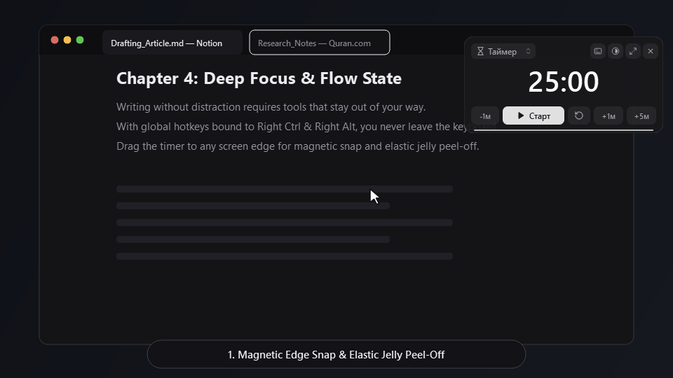
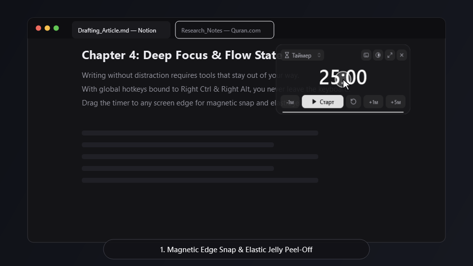
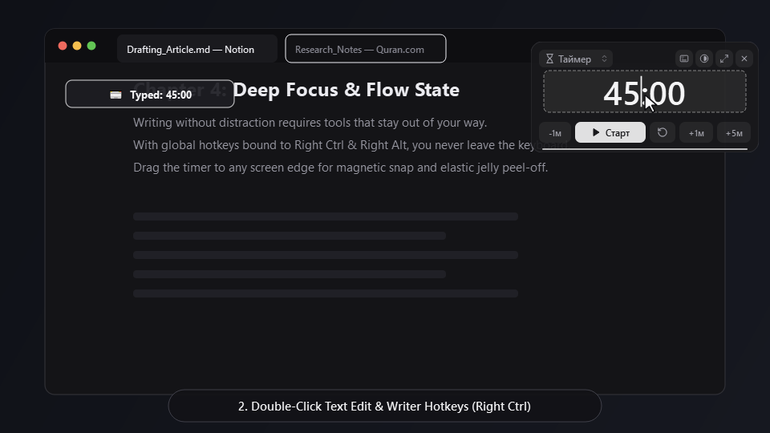
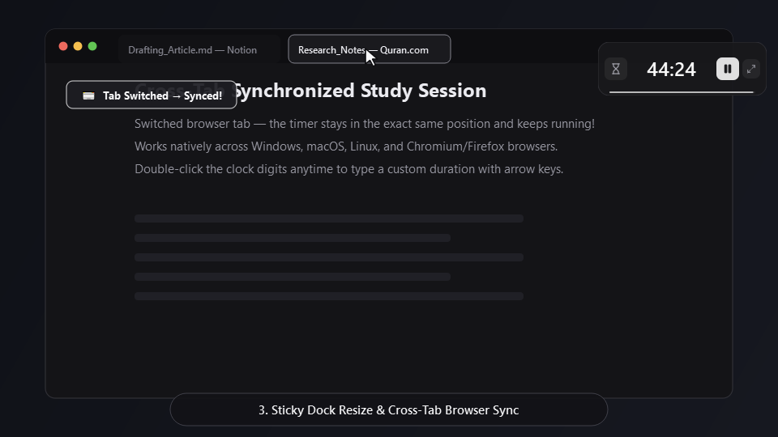

# Jelly Timer — Minimalist Floating Timer & Stopwatch

<p align="center">
  
</p>

<p align="center">
  <b>Always-on-top floating desktop & browser timer with magnetic edge-snap, elastic jelly peel-off physics, and writer-friendly global hotkeys.</b>
</p>

---

## ✨ Key Features

- **🧲 Magnetic Edge-Snap & Elastic Jelly Peel-Off**  
  Throw the widget toward any screen border or corner to preview the snap zone (just like Windows 11 Aero Snap). When pulling it away from a docked edge, it stretches elastically and pops free with a crisp, unified ~1.2s spring recoil.
- **⌨️ Writer-Friendly Global Hotkeys (`Right Ctrl` / `Right Alt`)**  
  Control your timer while typing in Google Docs, Notion, or an IDE without ever leaving the keyboard or accidentally triggering shortcuts while typing normal words. Supports distinguishing **Left vs. Right** `Ctrl`, `Alt`, and `Shift` across Windows, macOS, and Linux.
- **✏️ Double-Click Inline Time Editing**  
  Single-clicking anywhere on the widget drags it smoothly. Double-clicking the timer digits opens a normal text cursor (`|`) with `←` / `→` arrow key navigation.
- **📐 Sticky Dock Resizing (`Mini` / `Medium` / `Large`)**  
  Switch between an ultra-compact pill (`Mini`), standard controller (`Medium`), and preset dashboard (`Large`). If docked to a screen edge or corner, resizing stays firmly anchored to that border.
- **🌐 Cross-Tab Synchronized Browser Extension (Manifest V3)**  
  Includes a ready-to-load Chromium / Firefox extension (`browser_extension/`) that synchronizes live countdowns, position, dock edge, and size across all open browser tabs in real time using Shadow DOM isolation.

---

## 📸 Screenshots

| 1. Elastic Jelly Peel-Off | 2. Double-Click Inline Edit | 3. Sticky Mini Capsule & Sync |
| :---: | :---: | :---: |
|  |  |  |

---

## 🚀 Quick Start (Desktop: Windows, macOS, Linux)

### 1. Run from Source
```bash
git clone https://github.com/I2Volt/Jelly_timer.git
cd Jelly_timer
pip install -r requirements.txt
python jelly_timer.pyw
```

### 2. Build Standalone App (`.exe` / `.app` / Linux Binary)
```bash
pip install pyinstaller
pyinstaller --noconsole --windowed --onefile --name "JellyTimer" jelly_timer.pyw
```
Automated multi-OS builds are also configured via GitHub Actions in [`.github/workflows/release.yml`](.github/workflows/release.yml).

---

## 🌐 Install the Browser Extension (Chrome / Edge / Brave / Opera / Yandex)

1. Open `chrome://extensions/` in your browser.
2. Enable **Developer mode** (toggle in the top-right corner).
3. Click **Load unpacked** (`Загрузить распакованное расширение`) and select the [`browser_extension`](browser_extension) folder.
4. The floating timer will appear on your active tabs and stay synchronized in position and time across all tabs!

---

## 📄 License

Released under the [MIT License](LICENSE).
